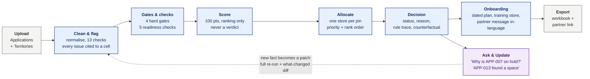

# Launchpad — Franchise Expansion Engine

Ops Hackathon · **Case 1, Franchise Partner Onboarding** · 8 slides

---

## Slide 1 — Title

# Launchpad
### Franchise Expansion Engine

> **Not "the AI decided." This rule decided, here is the row it read, and here is what
> would change it.**

A franchise expansion desk uploads one workbook and gets back a defensible decision for
every applicant — the reason in a sentence, the rule that produced it, and the paperwork to
act on it.

**Aayush Topiwala · Durgesh Panchal**

| | |
| --- | --- |
| **Live MVP** (no login) | https://launchpad-franchise-engine.vercel.app |
| **Code** | github.com/aayushtopiwala3-byte/launchpad-franchise-engine |
| **Video** | `[60-SECOND VIDEO LINK]` |

---

## Slide 2 — The problem

**Who.** The brand's expansion manager, daily. Behind them, city leads who sign off on sites,
and applicants waiting to hear back.

**What it costs today.** Applications arrive faster than one person can judge them. The
backlog is not the expensive part — the expensive part is that the judgements are not
reproducible, not explainable, and occasionally wrong in ways nobody finds for weeks.

**The seven sub-problems, intake to opening:**

| # | Stage | What goes wrong |
| --- | --- | --- |
| 1 | **Intake** | The sheet arrives messy. `"560 043"`, `"25 lakh"`, `"3000000"`, `"ground floor"` — each needs a judgement call, and each call is made differently twice. |
| 2 | **Eligibility** | Two coordinators read the same row and reach different answers. Nobody can say which was right. |
| 3 | **Ranking** | "Who is strongest in Mysuru?" has no written answer, so it is re-argued every week. |
| 4 | **Capacity** | A territory lists 3 open slots but only 2 pins are actually free. The third approval has nowhere to go. |
| 5 | **Allocation** | The same pin gets promised twice. Found weeks later, after a lease is signed. |
| 6 | **Communication** | An applicant asks why. The honest answer is "it was a judgement call." |
| 7 | **Opening** | No dated plan, no named training store, so "approved" and "open" are months apart for reasons nobody tracked. |

The sheet is not the problem. The absence of a **rule, a record, and a reason** is.

---

## Slide 3 — Scope

**What we solve.** Everything from the uploaded workbook to a decision an expansion manager
can defend out loud: cleaning and flagging the data, four hard gates, five readiness checks,
a 100-point rank, one-store-per-pin allocation, a dated onboarding plan, a partner message in
the applicant's language, and a six-sheet Excel export.

**What we deliberately leave out, and why:**

| Left out | Why |
| --- | --- |
| **Agreements and fees** | Legal and commercial terms are negotiated, not computed. A tool that drafted them would be asserting authority it does not have. |
| **KYC and background checks** | Regulated, identity-bearing, and already owned by another system. We would consume a verdict from it, never produce one. |
| **Site visits** | The one input that genuinely requires a human in the room. We tell you which sites are worth visiting; we do not pretend to have been. |
| **Training delivery** | We name the training store and the dates. Running the training is an operations job, not a software one. |
| **Revenue forecasting** | We have no store-level P&L. Forecasting without it would be the exact "plausible guess" this product exists to refuse. |
| **Live CRM / ERP integrations** | A two-day build cannot own a production integration responsibly. Excel in, Excel out, so it drops into the desk that exists today. |

The line is consistent: **we automate the judgements that have written rules, and we refuse
the ones that do not.**

---

## Slide 4 — Assumptions and data

Every number below is a **policy default, editable in Settings** — not a constant baked into
the code. Each one is an assumption, so each one gets a way to check it.

**The policy table (shipped defaults):**

| Policy | Tier 1 | Tier 2 | Tier 3 |
| --- | --- | --- | --- |
| Minimum investment (lakh) | 30 | 20 | 15 |
| Minimum space (sq ft) | 400 | 350 | 300 |
| Preferred space band (sq ft) | 400–1200 | 350–1000 | 300–800 |

Hard floor: below 75% of the tier minimum → **not proceeding**. Between 75% and 100% → **on
hold**, with the gap stated in lakh. Acceptable floors: Ground, Mall unit. Zero retail
experience is **not** a rejection — it scores zero on that component and adds a training week.

**Realistic time to open:** 3.0 months with space secured on an acceptable floor · 4.5 months
if the space is not yet identified, upper, or unknown · +0.25 months at zero experience.
Reservation window for held applicants: 45 days.

**The five states:** Approved · Waitlisted · On hold · Redirected · Not proceeding.
Redirected is advisory — it consumes no slot and reserves no pin, and it only exists when
there is a named free pin to point at.

**Pin code as a proxy for catchment**, because applications carry no territory ID and a pin
is the finest geography the sheet actually contains.

**How we would verify each one:**

| Assumption | How we check it |
| --- | --- |
| Tier investment and space minimums | Last year's franchise P&Ls — do stores below the minimum actually underperform, and by how much? |
| Realistic time to open | Opened-store timelines — the real distribution of approval-to-opening, split by whether space was secured at approval. |
| The gates, the weights and the five states | A manager calibration session on **50 past applications**: they decide blind, we compare, and every disagreement is traced to the rule that caused it. That number becomes the pilot's gate. |
| Pin code as catchment | Catchment data from existing stores — do the pins we treat as one territory actually share customers? |

If a check fails, the fix is a threshold in Settings, not a code change. That is the point of
making them editable.

---

## Slide 5 — Solution and MVP

Everything in the blue path is **one pure TypeScript function** — no network, no clock, no
model. `runPipeline(input, policy, asOfDate)` returns the same `resultHash` on any machine,
forever.

**The AI gets four narrow jobs, and none of them is "decide":**

| Job | Deterministic twin when AI is off or fails |
| --- | --- |
| Read a messy "current business" field | Keyword classifier over the same text |
| Flag notes that contradict the columns | Rule-based cross-check (DQ-13) |
| Pick an intent for an unmatched chat question | Regex router — tried first, always |
| Polish a reason sentence | The rule-generated sentence, unpolished |

It may **add** a data-quality finding. It may never **remove** one, state what a cell
contains, or touch a status, a rank or an allocation.

**35 named rules · 13 screens · 318 tests · 6-sheet export · 0 verdicts from a model.**

---

## Slide 6 — Adoption

**The daily user** is the expansion manager. Today they open the sheet, read rows, and decide.
Tomorrow they open Launchpad, read the five tiles, and spend their day on the rows the tool
flagged rather than the rows it already settled.

**What actually changes for them:** the sorting is done, the arithmetic is done, and the
reason is already written. What does not change is who is accountable — the manager still
signs off, and the tool still has to convince them row by row.

**The three objections we expect, and the answer to each:**

| "…" | The answer |
| --- | --- |
| **"It will make the wrong call and I will wear it."** | It recommends and explains; it never sends anything. Every decision shows the gate, the threshold and the cell it read. If it is wrong, you can see *where* it is wrong in one click — which is more than the status quo offers. |
| **"It will overrule my judgement."** | Humans override, with a recorded reason, and a locked override survives every later re-run. The Calibration screen then groups disagreements by rule — so an override is not a workaround, it is the input that fixes the rule. |
| **"Someone in head office set these numbers and I have to live with them."** | The team owns the policy. Every threshold is editable, and changing one shows you the cost — "this moves 3 applicants from Approved to Hold", named — *before* you commit. |

And the quiet one: **nothing sends automatically.** No applicant hears anything until a
person decides they should.

---

## Slide 7 — Rollout

**Phase 1 — four-week shadow pilot, Mysuru and Tumakuru.** One Tier 2 and one Tier 3 city.
The tool decides in parallel; the managers decide as they always have; nothing the tool says
reaches an applicant. Every disagreement is logged against the rule that caused it.

> **Gate to phase 2: 80% agreement, with every disagreement explained.** Not 80% and a shrug —
> each of the remaining 20% has to be traced to either a rule we should change or a judgement
> the rules cannot hold. Unexplained disagreement means we are not ready.

**Phase 2 — all Tier 2 and Tier 3, human sign-off on every decision.** The tool drafts, the
manager releases. Overrides keep feeding calibration.

**Phase 3 — Bengaluru, partner links, CRM.** Tier 1 is highest-stakes, so it goes last.
Applicants get their own read-only link, and decisions start flowing to the CRM instead of
being re-keyed.

**What we measure:**

| Metric | Why it is the right one |
| --- | --- |
| Days to decision | The backlog is the presenting complaint. |
| Share of decisions with a recorded reason | Target 100%. This is the real product. |
| Weekly active users | A tool nobody opens has not been adopted, whatever the agreement rate says. |
| Override rate, **falling below 20%** | Rising overrides mean the policy is wrong; we want to see it fall as calibration feeds back. |
| Approved-to-opened rate | Catches approvals that were never really viable. |
| Days to opening | The thing the business actually cares about. |

**The monthly override review.** Calibration groups every disagreement by rule ID and names
the pattern — *"7 of 9 overrides fired on R-03 (upper floor), all in Tier 3"* — with a
one-click jump to that setting. The review changes the policy, the change is versioned, and
the next month's numbers say whether it helped. **The loop is the product.**

---

## Slide 8 — Cost, reuse, and what we would build next

**What it costs at real volume.** Measured on the live deployment, not estimated: a fresh
classification call is **136 input / 22 output tokens, $0.00010**, and the sample set spends
24 calls across 28 applications.

| At 1,000 applications a month | |
| --- | --- |
| AI calls | ~860 (the rest are cache hits) |
| **AI cost** | **about $0.09 a month** |
| Hosting | Vercel free tier — the engine runs in the browser, so there is no server to scale |

Against that: if an application takes an expansion manager 15 minutes to read, decide and
write up, 1,000 applications is **250 hours a month**. That ratio is the argument. It is also
an assumption — the pilot's time-to-decision metric is how we confirm it.

A per-session ceiling (default **$0.50**) stops spending before it surprises anyone, and
the product keeps deciding after it trips, because no verdict needed the model.

**Where else this goes.** The shape — *applications against capacity at fixed locations,
decided by written rules* — is not specific to retail franchising:

- **Delhivery collection centres** — same pin-code catchment, same one-per-location constraint
- **Amazon "I Have Space" partners** — higher volume, lower value per decision, so automation matters more
- **Auto dealerships** — fewer applicants, much higher stakes, and a stronger need to defend a rejection
- **Clinic and diagnostics franchises** — add licensing as a gate, and the rest transfers unchanged

**What we would build next**, in order:

1. **Learn the weights from outcomes.** We have the override log and the approved-to-opened rate; the score weights should be fitted to them rather than chosen by us.
2. **The map (spec §9.6).** Territories, stores and applicants by pin centroid — the one piece of the brief we did not ship.
3. **Real catchment instead of pin codes.** Drive-time isochrones from existing-store data, replacing the proxy on slide 4.
4. **A second decision-maker.** Capacity planning the other way round: given a target of N new stores, which territories should we be recruiting in, and who should we be calling?

---

### The line to leave them with

> Rules decide. AI explains. And when you ask why, the answer is a rule, a row and a
> number — never a vibe.
