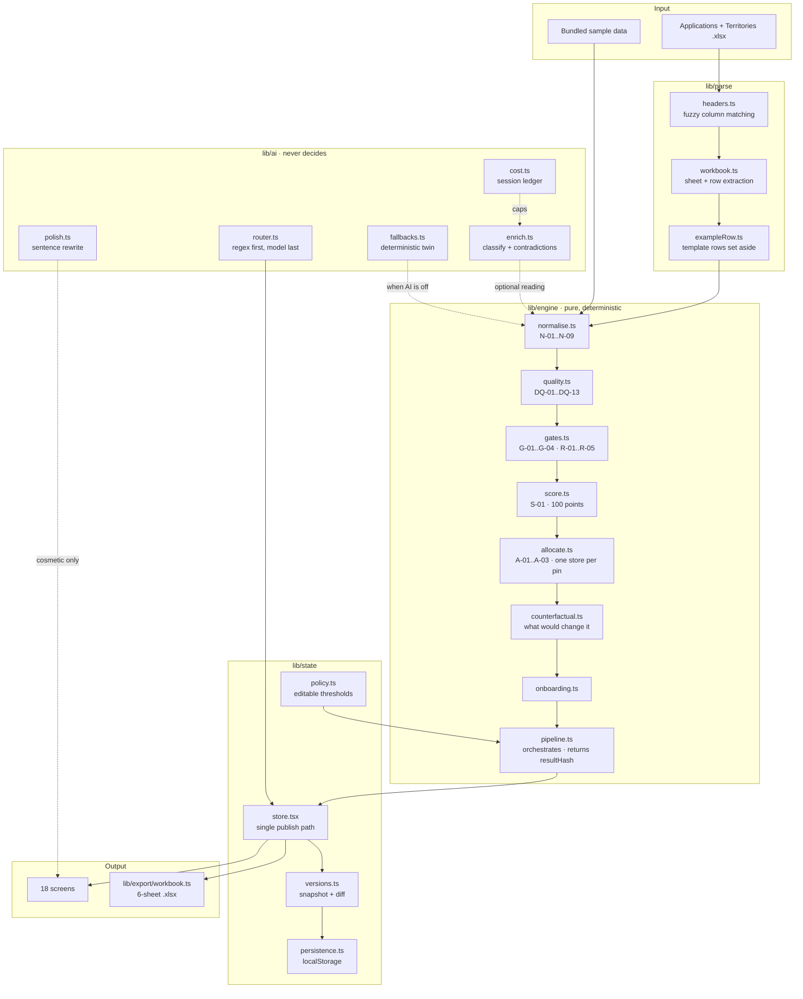

# Launchpad — Franchise Expansion Engine

Upload the Applications and Territories workbook. Get back a decision for every applicant,
the reason in one sentence, the rule trace behind it, an onboarding plan, and an Excel file
you can hand to a franchise owner.

Around that engine sit three workspaces: a **Command Centre** for the expansion head, a
**Partner Acquisition** desk for the leads who have not applied yet, and an **Onboarding &
Launch** tracker for the partners who were approved. None of them can move a verdict.

**Live, no login: https://launchpad-franchise-engine.vercel.app**

Built for Ops Hackathon Case 1 by **Aayush Topiwala** and **Durgesh Panchal**.

---

## The one rule that shapes everything

**Rules decide, AI explains.**

Every status, score, rank and pin allocation is produced by pure TypeScript in `lib/engine/`.
Nothing in that folder calls a model, reads the clock, or touches the network. Turn the AI
off entirely and the product still returns the same verdicts — the reasons just get plainer.

Three rules follow from it:

| Rule | What it means in the code |
| --- | --- |
| **Never invent a fact** | A value the file did not state renders as *not stated*, never as a guess or a zero. `null` means "the file was silent". |
| **A display switch never moves a verdict** | Explain mode, language and AI toggles are annotation only. `tests/acceptance/switches.test.ts` runs the whole pipeline with every switch on and every switch off and asserts the statuses are identical. |
| **A verdict is never changed quietly** | Every recompute writes a version with a snapshot and a diff. The timeline names exactly which applicants moved, including the ones who only lost a rank. |

The workspaces inherit it. A lead's stage records how far a conversation has got and
assesses nobody; a journey stores only completed tasks and document states, and every
milestone status, percentage and launch verdict is derived from those two, so there is no
second status to drift. A partner who finishes every task of their own reads *Awaiting
brand authorisation* — completing a personal checklist is not permission to open a store.

## Run it

```bash
npm install
npm run dev      # http://localhost:3000
```

Click **Load sample data** on the home page — 28 applications across 8 territories, with the
awkward rows (a duplicate, a pin claimed by an existing store, a blank investment field)
deliberately left in.

No API key is needed. Every AI touchpoint has a deterministic fallback.

```bash
npm test         # 669 tests
npm run typecheck
npm run build
```

### Optional: switch the AI on

```bash
cp .env.example .env.local   # then set GEMINI_API_KEY
```

The key is server-side only. The browser never sees it — all calls go through `/api/ai`.
A cost ledger caps a session at $0.50 by default (`NEXT_PUBLIC_AI_COST_CEILING_USD`).

## What the AI is allowed to do

Four narrow jobs, each with a deterministic twin that runs when the model is off, fails, or
exceeds the budget:

1. **Read free text** — classify a messy "current business" field into a category, with the
   evidence quote it relied on.
2. **Flag contradictions** — notice that the notes say one thing and the columns say another.
3. **Pick an intent** — when a chat question does not match the regex router.
4. **Polish a sentence** — rewrite a rule-generated reason more fluently.

It is never allowed to decide, to score, to rank, or to state what a cell contains. When AI
is switched on it may **add** a data-quality finding; it may never **remove** one the
deterministic twin found.

## Components map



## The screens

| Route | What it answers |
| --- | --- |
| `/` | Load a workbook, the sample, or a blank template |
| `/dashboard` | How many approved, waitlisted, held — and the export button. Nine filters narrow one set that every card, the funnel and every panel are computed from, so a card and the list it links to can never disagree |
| `/applicants` | Every row with its one-line reason, filterable |
| `/applicants/[id]` | The full rule trace, score breakdown, onboarding plan, partner message |
| `/territories` | Capacity, pins held, pins free, why a slot is still empty |
| `/quality` | Every data-quality finding, blocking first, with where in your file it lives |
| `/timeline` | Every version, what caused it, exactly which decisions moved |
| `/chat` | Ask why; state a new fact and apply it as a patch |
| `/policy` | Edit thresholds and re-run; the diff shows the cost of the change |
| `/calibration` | Thumbs on reasons, aggregated |
| `/features` | The switches — including explain mode and AI on/off |
| `/system` | Health, the AI cost ledger, the full event log |
| `/partner/[token]` | A read-only view an applicant can be sent |
| `/acquisition` | Leads before they apply: workload, stages, follow-ups now due. Sortable on seven columns, and a pipeline board that refuses a move it cannot honestly make |
| `/acquisition/[leadId]` | One conversation — history, AI qualification, outreach drafts, handover |
| `/onboarding` | Every approved partner's journey, ranked by who is blocking it |
| `/onboarding/[id]` | One journey: ten weighted milestones, tasks, documents, launch readiness |
| `/owner` | The franchise owner's own portal, reachable in one click from the dashboard |

## The export

Six sheets. The **Decisions** sheet echoes your uploaded columns word for word and appends
the decision beside them, so you can diff it against your own file and see that nothing was
rewritten behind your back. Values the file never stated read *Not stated*, never blank.

Two exports of the same run produce byte-identical files — pinned by a test.

## Determinism

`resultHash` on the dashboard is a hash of the decisions. The same workbook, the same policy
and the same as-of date always produce the same hash, on any machine. The engine never reads
`Date.now()`; the as-of date is an explicit input.

## Roles, and what the role control is not

Two roles share the same data: **Expansion team** runs the pipeline, the policy and the
acquisition desk; **Franchise partner** records their own onboarding and nothing else. A
partner may submit a proposed correction to their application — asking is not deciding — but
only the expansion side can answer it.

The check runs in the reducer, ahead of every case, because that is the only path by which
any of this state changes. Refusing a write there rather than hiding a button is what makes
the rule a rule: `tests/state/access.test.ts` asserts the mapping covers all seventeen kinds
of mutating action, and a refusal says in words that nothing was written.

**This is not authentication.** There is no login, no server and no identity provider in this
build. The role is a value in this browser — anyone who can open the page can change it, just
as they could edit the stored JSON directly. What it does buy is that a mistaken click in the
wrong workspace cannot alter a record that workspace does not own. What it does not buy is
protection from someone who wants to get around it. Production use needs a real identity
provider and a server that re-checks every write. The app says this on `/policy` rather than
letting the control imply a boundary it does not have.

## Layout

```
app/           screens and the single /api/ai route
components/    UI, decision cards, shell, the three workspaces
lib/engine/    the decision rules — pure, no I/O
lib/ai/        the narrow AI jobs, each with a deterministic fallback
lib/parse/     workbook reading and column matching
lib/export/    the six-sheet .xlsx builder
lib/state/     store, versions, persistence, policy, and the capability model
lib/command/   command-centre arithmetic — KPIs, funnel, bottlenecks, and the filter scope
lib/crm/       lead logic — validation, duplicates, sorting, the pipeline board, handover
lib/onboarding/ the ten milestones, their tasks and documents, and the derived journey
tests/         669 tests across 34 files
```
